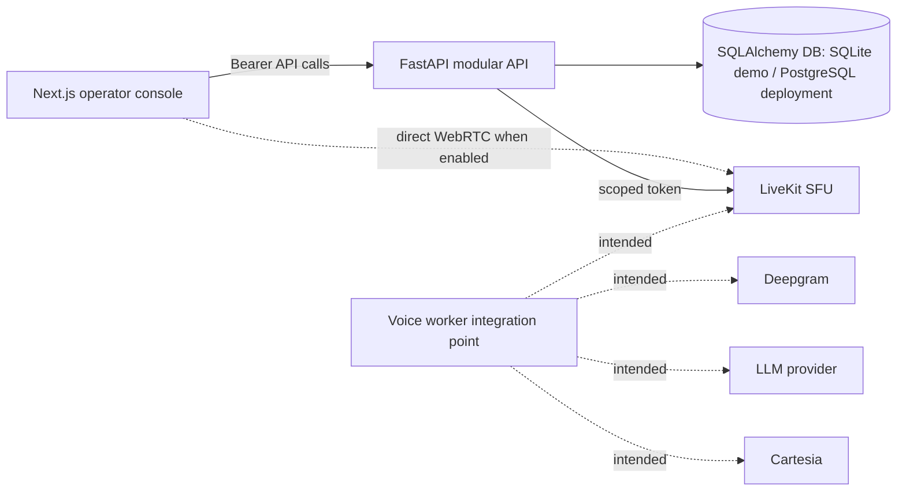

# Architecture and technology decisions

The current delivery is intentionally a modular monolith. FastAPI contains auth, tenant-scoped business routes, and agent/session configuration. Browser-to-API requests use a signed bearer JWT. Tenant ID is derived from a validated membership claim, never accepted as a route/body parameter. SQLAlchemy relational records provide the working demo persistence. SQLite is used for low-friction local runs; PostgreSQL can be selected through `DATABASE_URL`.

**Why these choices:** FastAPI/Pydantic yield typed HTTP contracts and fast feedback; SQLAlchemy isolates data access and supports PostgreSQL migration; Next.js/React gives a recruiter-friendly client. LiveKit token issuance is optional, and audio remains a provider-dependent integration. The project does not pretend a mock session is speech recognition or speech generation. For a real deployment, use OIDC and secure HttpOnly session cookies (or a BFF), PostgreSQL row-level security defense-in-depth, object storage for uploads, Redis and a queue only when background ingestion is added, and OpenTelemetry exporters.

**Voice sequence target:** browser requests `/api/voice/sessions` → API authorizes tenant and creates conversation → API mints room-scoped JWT → browser connects directly to LiveKit → worker joins and runs VAD/STT/LLM/tool/TTS → events update transcript → session ends and summary is persisted. The optional LiveKit token/session-creation route, agent dispatch metadata, separate STT/LLM/TTS/VAD worker, and browser microphone/track connection flow are implemented. The external provider-backed end-to-end call remains unverified because this environment has no provider credentials or LiveKit server.

Technology onboarding: JWT carries user/org scope, SQLAlchemy owns tenant-scoped queries, Next renders the admin experience, and the eventual LiveKit client handles media transport independently from business APIs. Common failure modes include stale/expired tokens, missed tenant filters, CORS mismatch, and invalid provider credentials. Interview framing: explain trusted tenant scope from the server-verified membership; distinguish signaling/control-plane API from WebRTC media plane; explicitly describe the unimplemented provider pipeline.
