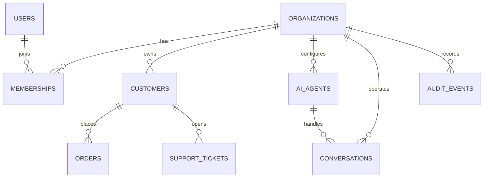

# Database

Implemented SQLAlchemy tables: organizations, users, memberships, customers, orders, support_tickets, ai_agents, conversations, audit_events. A migration is generated from the metadata and is the authoritative schema initializer; `Base.metadata.create_all` also supports minimal test startup. Tenant-owned tables carry `organization_id` and query filters derive the value from membership. Foreign keys and tenant/customer uniqueness constrain core rows.

Planned/not implemented: agent version snapshots, verification record persistence, appointments, transcript segments, tool execution records, handoff queue, knowledge bases/documents/chunks/pgvector embeddings, usage and retention policies. Do not infer those entities exist from the broader product vision.

