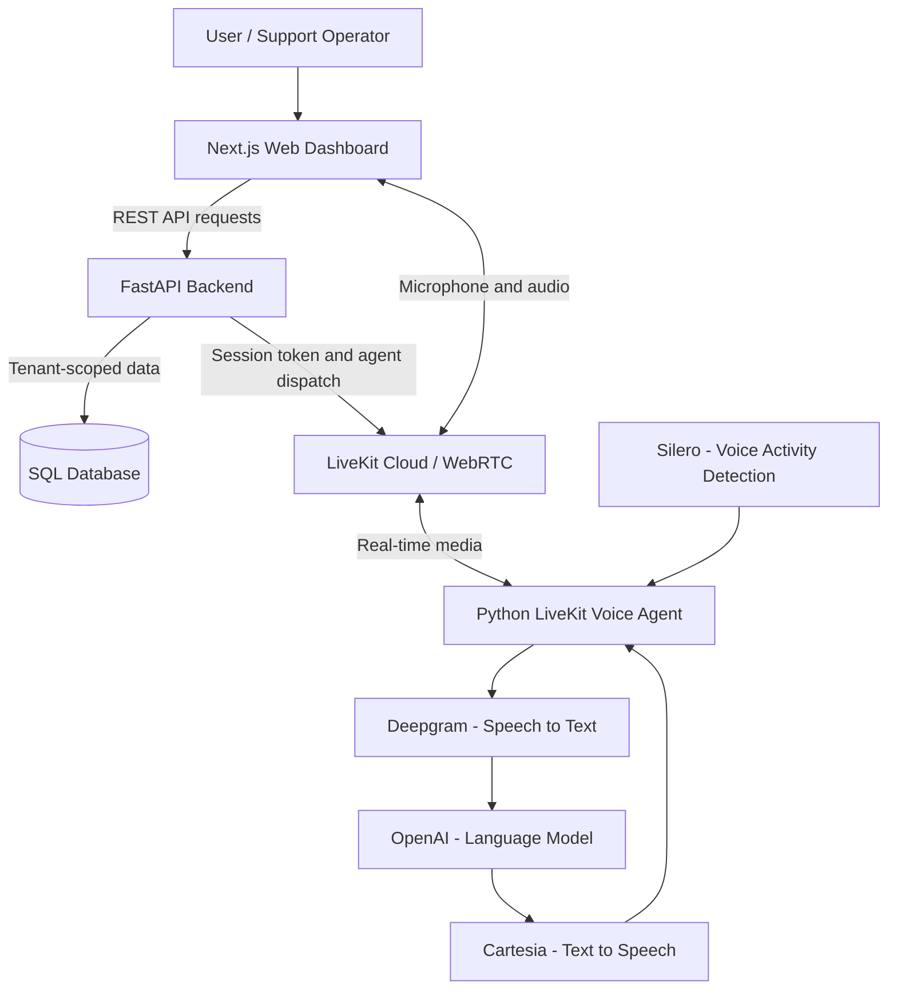
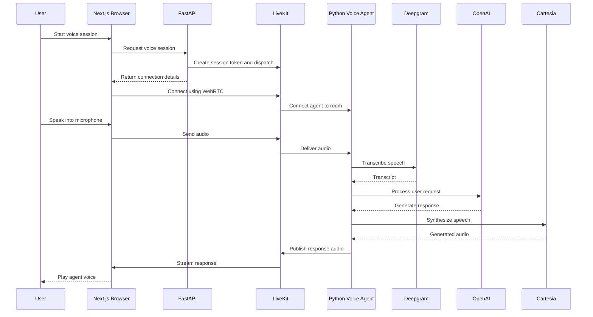

# VoiceSphere AI 2.0 — System Architecture

VoiceSphere AI 2.0 is a multi-tenant AI contact-center engineering portfolio project built with Next.js, FastAPI, LiveKit, Deepgram, OpenAI, Cartesia, and Silero VAD.

## 1. High-Level Architecture

## 2. Voice Conversation Flow

## 3. Technology Stack

| Layer | Technology | Purpose |
|---|---|---|
| Frontend | Next.js, TypeScript | Dashboard and browser interface |
| Backend | FastAPI, Python | REST APIs, authentication, session issuance |
| Database | SQLAlchemy, SQLite / PostgreSQL | Application data persistence |
| Real-time transport | LiveKit | WebRTC and agent dispatch |
| Voice agent | Python, LiveKit Agents | Voice pipeline orchestration |
| Speech recognition | Deepgram Nova-3 | Speech-to-text |
| Language model | OpenAI GPT-4.1 mini | Response generation |
| Speech synthesis | Cartesia Sonic-3 | Text-to-speech |
| Voice detection | Silero VAD | Speech activity detection |
| Infrastructure | Docker, Terraform | Packaging and infrastructure configuration |
| CI | GitHub Actions | Automated project validation |

## 4. Core Application Modules

- AI Agents: Agent configuration and management
- Customers: Tenant-aware customer records
- Orders: Order management workflows
- Support Tickets: Support request tracking
- Voice Playground: Mock or configured LiveKit sessions
- Audit Log: Application activity and audit records
- Authentication: User access and role-based authorization

## 5. Implementation and Validation Status

The application includes a runnable FastAPI backend, Next.js dashboard, database-backed business workflows, and a separate LiveKit voice worker.

The repository supports an explicit offline mock voice mode. The LiveKit browser transport and provider-backed voice pipeline are implemented in code, but a complete real microphone-to-agent conversation has not been independently verified as part of the published repository validation.

The voice worker currently does not integrate customer/order/ticket business tools. The application is a portfolio MVP, not a production-ready contact-center platform.

GitHub Actions validates the configured Python, web, voice-worker, Terraform, and container checks.

## 6. Security Notes

- Never commit real API keys or credentials.
- Keep local environment files outside Git tracking.
- Use fictional demonstration customer data.
- Treat production deployment, secrets management, and operational hardening as separate future work.
